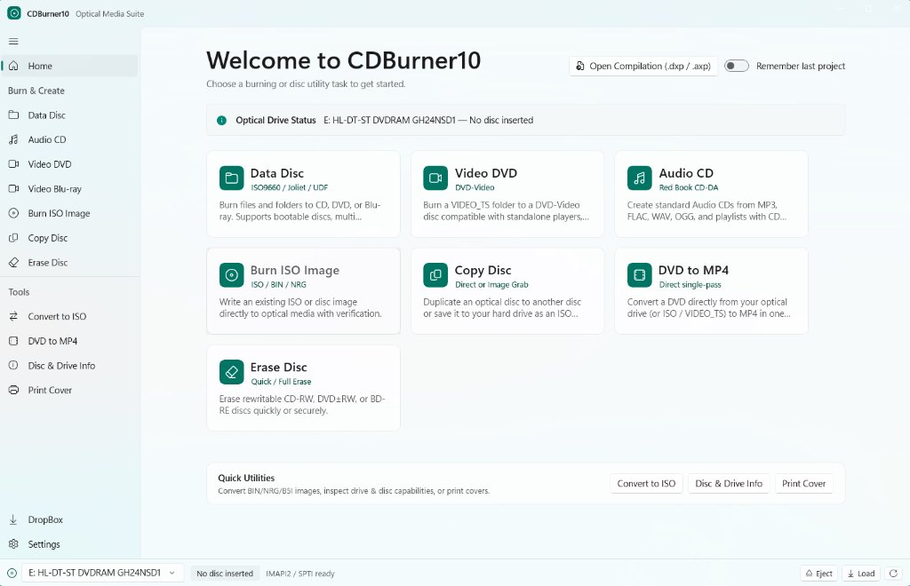

# CDBurner10 — Open-Source 64-bit Optical Media & DVD Archiving Suite

An independent, 100% open-source (**GNU GPL v3.0**) optical media authoring, burning, ripping, and DVD archiving suite for Windows 10/11 built from the ground up on **.NET 10 (win-x64)** and **WinUI 3 (Windows App SDK 1.7)** — with zero proprietary SDKs and zero closed-source DLLs.

While originally inspired by classic Windows disc-burning utilities (and retaining compatibility with `.dxp` / `.axp` compilation files, `UserSettings.ini` import, and `cdbxpcmd` CLI syntax), **CDBurner10** is a standalone, clean-room open-source project powered by Windows IMAPI2, SPTI SCSI MMC, NAudio, TagLibSharp, FFmpeg, and 64-bit `libdvdnav`/`libdvdread`/`libdvdcss`/`libcdio`.

## Architecture

- **`src/CDBurner10.Core`** — UI-independent `.NET 10` (`win-x64`) core library:
  - **Optical Burning & Drive Access:** Native Windows **IMAPI2** (`IFileSystemImage`, `IDiscFormat2Data`, `IDiscFormat2Erase`, `IDiscFormat2TrackAtOnce`) + pure-C# **SPTI SCSI MMC-3/5** (`IOCTL_SCSI_PASS_THROUGH_DIRECT`) for Data Discs (ISO9660/Joliet, UDF 1.02–2.60, El Torito bootable, multi-session import), DVD-Video UDF 1.02 bridge, ISO burning & sector-by-sector verification, Audio CD TAO and SAO/DAO-96 with CD-Text, disc erasing, and linear disc grabbing.
  - **Navigation-Driven DVD Reading:** 64-bit **`libdvdnav` + `libdvdread` + `libdvdcss`** (`DvdNavigationWalker`, `DiscReadMode.Navigated`), following the disc's own PGC/cell playback path and automatically selecting the correct main movie title. Bypasses ARccOS protection or bad sectors.
  - **Unfinalized DVD-R / DVD+R / DVD-RW Recovery:** `UnfinalizedDvdReader`, scanning and streaming raw MPEG-2 Program Stream sectors when no UDF / `VIDEO_TS.IFO` filesystem was finalized.
  - **Single-Pass DVD → MP4:** `DvdVideoConverter` directly from an optical drive, `.iso`, or `VIDEO_TS` folder via **FFmpeg**, with automatic GPU hardware H.264 encoding (`h264_nvenc` / `h264_qsv` / `h264_amf` / `h264_mf` → `libx264` fallback), `bwdif` deinterlacing, title selection, audio/subtitle tracks, and optional burned-in subtitles.
  - **Open-Source Audio & Ripping:** Audio playback, CD-DA ripping & CD-Text, ReplayGain, crossfading, and CUE/M3U/WPL/NRA support via **NAudio**, **TagLibSharp**, **FFmpeg**, and Win32 CD-DA IOCTLs.
  - **ISO & Compilation Tooling:** Pure-managed `BIN` / `NRG` / `B5I` → `ISO` converters, `.dxp` / `.axp` project compatibility, disc spanning, cover printing, and JSON settings (with portable mode & legacy `UserSettings.ini` import).
- **`src/CDBurner10.Cli`** (`cdbxpcmd.exe`) — Full CLI parity (`--list-drives`, `--eject`, `--load`, `--wait-for-disc`, `--erase`, `--burn-data`, `--burn-audio`, `--burn-video`, `--burn-iso`, `--dvd-to-mp4`).
- **`src/CDBurner10.App`** (`CDBurner10.exe`) — Unpackaged 64-bit Windows 11 **WinUI 3 + Mica** desktop app featuring cached pages (including **Copy Movies from Disc** with recursive subfolder scanning and parallel legacy-to-MP4 conversion), floating DropBox window, Fluent `ContentDialog`s (including **Rip Audio CD** with **Export Tracks to...**), multi-session disc capacity visualization, and automatic Audio Compilation / temp-rip session persistence across restarts.
- **`src/CDBurner10.Upscaler`** (`CDBurner10.Upscaler.exe`) — Companion 64-bit **WinUI 3 + Mica** GPU video upscaling app powered by **`libmpv` + OpenGL GLSL shaders** (**Anime4K v4** modes `A`, `B`, `C`, `A+`, `B+`, `C+` in HQ & Fast tiers) and **ONNX Runtime (DirectML / CPU)** (**ArtCNN**), with FFmpeg H.264/HEVC encoding (NVENC / QSV / AMF / `libx264` / `libx265`), automatic deinterlacing, BT.709 color tagging, and SAR/DAR preservation.
- **`tests/CDBurner10.Tests`** — Automated xUnit test suite covering compilations, session persistence, ISO converters, `libdvdnav` / `libdvdcss`, DVD-to-MP4, unfinalized DVD recovery, disc spanning, movie copying, settings, audio engine, and CLI execution.

## CDBurner10 Upscaler

**CDBurner10 Upscaler** (`CDBurner10.Upscaler.exe`) is a companion desktop & CLI tool for offline 2×/4× GPU video upscaling — ideal for DVD rips, animated movies, and archived home videos.

- **Backends & Presets:**
  - **libmpv + GLSL Shaders:** Anime4K v4 (`Anime4K_A`, `Anime4K_B`, `Anime4K_C`, `Anime4K_A_Plus`, `Anime4K_B_Plus`, `Anime4K_C_Plus`) with HQ and Fast shader tiers, rendered via an offscreen OpenGL context with async PBO readback.
  - **ONNX Runtime (DirectML / CPU):** ArtCNN tiled neural upscaling presets.
- **Encoding & Fidelity:** Supports H.264 and HEVC output (`.mp4` or `.mkv`) with automatic GPU encoder detection (`nvenc` / `qsv` / `amf`) and high-quality `libx264`/`libx265` CRF fallback, automatic deinterlacing, BT.709 color conversion, and preserved aspect ratio (SAR/DAR) & audio/subtitle streams.
- **Requirements:** `ffmpeg` + `ffprobe` on `PATH` (e.g. `winget install Gyan.FFmpeg`) and `libmpv-2.dll` next to the executable (or configured in Upscaler Settings) for GLSL shader presets.
- **CLI Usage:**
  ```powershell
  CDBurner10.Upscaler.exe --cli-upscale "<input-video>" <presetId> "<output-folder>" [mp4|mkv]

  # Example (Anime4K B+ to MP4):
  CDBurner10.Upscaler.exe --cli-upscale "D:\Movies\film.mp4" Anime4K_B_Plus "D:\Upscaled" mp4
  ```

## Build & Run

Requires **.NET 10 SDK** on Windows (`win-x64`).

DVD-to-MP4 conversion and exotic audio codecs additionally use **ffmpeg** and **ffprobe** on `PATH` (or placed next to `CDBurner10.exe`). Install with `winget install Gyan.FFmpeg`.

```powershell
# Build entire solution (Release, x64)
dotnet build CDBurner10.sln -c Release -p:Platform=x64

# Run tests
dotnet test tests/CDBurner10.Tests/CDBurner10.Tests.csproj -c Release -p:Platform=x64

# Publish self-contained 64-bit GUI, CLI & Upscaler to ./deploy
dotnet publish src/CDBurner10.App/CDBurner10.App.csproj -c Release -p:Platform=x64 -o deploy
dotnet publish src/CDBurner10.Cli/CDBurner10.Cli.csproj -c Release -p:Platform=x64 -o deploy
dotnet publish src/CDBurner10.Upscaler/CDBurner10.Upscaler.csproj -c Release -p:Platform=x64 -o deploy

# Build 64-bit MSI installer (requires WiX Toolset v7)
.\installer\build-msi.ps1 -Version 10.x.x.x
```

## License

**CDBurner10** is free software licensed under the **GNU General Public License v3.0 or later (`GPL-3.0-or-later`)**. See [LICENSE](LICENSE) for full terms.
